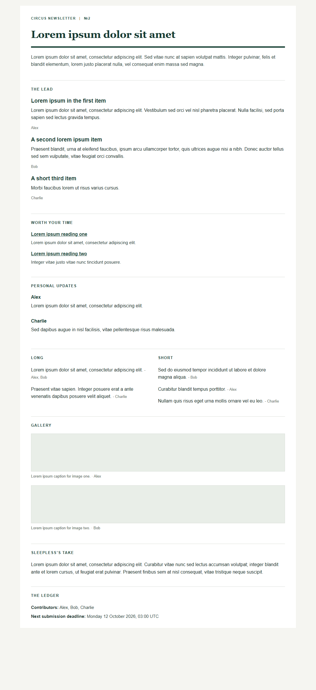

# Circus Newsletter

A Windows newsletter pipeline for collecting email submissions, preparing AI-edited or deterministic fallback drafts, rendering HTML/plain text, and delivering scheduled issues. Private settings, credentials, roster, submissions, delivery journals, and local operational tools are excluded from the release source.

## Sample newsletter

[View the sample HTML](https://htmlpreview.github.io/?https://github.com/Strajevski/Sleepless-Newsletter/blob/main/templates/sample-issue.html) · [Download the HTML](https://raw.githubusercontent.com/Strajevski/Sleepless-Newsletter/main/templates/sample-issue.html)

This example uses lorem ipsum and fictional contributors, including the Long and Short columns. The Gallery is intentionally blank. The browser preview uses a third-party viewer and will work after this repository is public; you can also download the HTML and open it locally.



## Requirements

* A Windows computer acting as the server, able to remain on, awake and connected to the internet during scheduled operations. Windows 11 26H2 is the tested version; other versions may work but are not confirmed here.
* A dedicated Gmail inbox or Google Workspace account with 2-Step Verification and app-password access. The system receives submissions through IMAP and sends issues, reminders and invitations through SMTP. Workspace administrators must permit this access.
* OpenAI Codex CLI, signed in using a ChatGPT account with access to the configured editing and image-captioning models. The current release uses Codex subscription allowances; API-key billing and other model providers are not yet supported.
* [Python](https://www.python.org/downloads/) 3.11 or later.
* A writable installation folder and permission to register Windows scheduled tasks.

Support for other email providers and AI providers/API-based access is planned for later releases. Setup installs the required Python dependencies. Git is optional when installing from a ZIP; follow the Codex CLI installation instructions for any prerequisites of your chosen installation method.

## Install, check, and uninstall

See the [installation and uninstall guide](INSTALL-UNINSTALL.md) for mailbox setup, configuration, checks, task activation and removal. Use a local, user-writable folder, for example `SleeplessNewsletter` under your Windows Local AppData directory. Configuration and the Python environment are created beside the code, so avoid `Program Files` rather than elevating setup to work around folder permissions.

```powershell
python scripts/setup.py
.\.venv-host\Scripts\python.exe scripts/doctor.py
.\.venv-host\Scripts\python.exe scripts/doctor.py --online
.\scripts\uninstall.ps1
```

Setup creates or reuses the local .venv-host environment and preserves existing settings and data. Doctor runs local checks by default; --online adds read-only authentication and usage checks without sending messages or generating AI content. Uninstall previews by default; add -Apply for confirmed removal of owned tasks and the environment, preserving private data and credentials. Automation requires separate, deliberate task installation. Details: [setup](docs/setup.md), [uninstall](docs/uninstall.md).

## How it works

Contributors send ordinary emails to a dedicated newsletter inbox, or reply to its invitations and reminders. A private roster identifies whose submissions to accept and where to deliver the finished newsletter. One contributor can send several emails during the week; the editor considers them together, including follow-up explanations and explicit corrections.

Scheduled checks collect new messages and save their text and attachments locally. The system assembles eligible submissions into a rolling bundle for the current issue. At the configured deadline it freezes that bundle, giving the editor a fixed set of material to work from. Messages from unrecognised senders or requiring review are retained with flags rather than treated as accepted contributions.

The AI editor uses the submitted text to select, organise and lightly edit news and personal updates, include relevant submitted links, and write an editorial. Explicitly submitted Long and Short positions appear in their own columns, with shared positions attributed to their contributors. The editor can also refer to summaries of recently delivered issues. A separate image-captioning stage uses submitted images and their matching submission context to prepare the Gallery.

The renderer turns the resulting issue into an HTML newsletter and a plain-text alternative, with contributor attribution, a gallery and the next deadline. Submitted non-image files and a text copy of the eligible submissions are attached separately. Image optimisation prepares a suitable outgoing copy when necessary, while the archived originals remain intact.

At the scheduled delivery time, the system sends the issue privately to the roster through the configured mailbox. It records delivery results so later checks can distinguish recipients already accepted by the mail server from those still pending. After successful delivery, invitations open the next cycle; reminders go out before its deadline. Optional Discord notifications report operational events.

Retries, fallback drafts and delivery holds handle failures without assuming that every service call succeeds; their behaviour is explained below. Once configured and enabled, the scheduled tasks perform the routine work without an open terminal. Logs, generated previews and manual controls remain available for inspection or intervention.

The scripts and archives run on your computer, but AI processing is provided by OpenAI: submitted text and images used for captioning are sent to the configured models. Newsletter identity, wording, timing, model choices and optional features are configurable.

## Configuration

| File | Responsibility |
| --- | --- |
| config/settings.json | Private newsletter/editor identity, headings, email connections, Codex overrides, notification switch, and data directory. Start from settings.example.json. |
| config/roster.json | Private members, accepted sender addresses, optional pronouns, and delivery addresses. Start from roster.example.json; never use fictional recipients for live delivery. |
| config/schedule.json | Cutoff, image preparation, editor retry, reminder, invitation, delivery windows/retries, and inbox frequency. |
| config/editor.json and config/captioner.json | Models, reasoning effort, prompt selection, processing limits, and captioning enablement. |
| config/delivery.json | Sending policy and issue holds. |
| config/relays.json | Empty public relay default. |
| config/relays.local.json | Optional private relay configuration, used instead of the public default when present. Start from relays.example.json and keep real identities private. |
| config/secrets/ | Machine-bound Windows DPAPI credentials with restricted permissions. Never copy these as portable credentials. |

See [settings](docs/settings.md) and [schedule](docs/schedule.md) for fields and examples. storage.data_directory defaults to the installation folder, independent of the terminal's working directory. Runtime folders (issues, state, logs, revisions, announcements, output) can move to a separately configured data folder; code, configuration, templates, prompts, and credentials remain installation-relative. Changing this setting does not move existing data: stop automation and preserve all journals during migration.

Gmail/Google Workspace remains the supported provider, using IMAP over implicit TLS on 993 and SMTP over implicit TLS on 465. Intake requires Gmail's unique-message-ID extension. Enter app passwords only through the hidden local setup prompt. Codex uses its saved CLI login; API-key environment variables are removed from child processes. Optional Discord dispatch requires both its configured switch and a stored webhook; missing webhooks do nothing.

## Default weekly cycle

These are the supplied defaults, all UTC year-round. Edit schedule.json to change them; they are not embedded in the task triggers.

| Event | Default |
| --- | --- |
| Submission reminder | Saturday 17:00 |
| Submission cutoff | Monday 03:00 |
| Image-size preparation | Monday 04:00 or later, once a draft exists |
| One deferred editor retry | Monday 07:00 |
| Issue delivery | Monday 08:00 |
| Next issue invitation | After complete delivery, within its configured invitation window |

Normal intake checks occur every 30 minutes, plus configured stage checks. The clock tasks check every minute; most ticks do not scan the inbox or run a model. A missed stage catches up on the next successful intake. See the optimisation, retries and fallbacks section below for failure handling and delivery windows.

## Runtime records and privacy

Each unique source message is archived separately. Raw emails, parsed submissions, attachment bytes, rolling input, frozen input, draft artifacts, caption manifests, optimisation manifests, and outbound journals live under issues/YYYY-Www in the configured data directory. Unknown, duplicate, empty, test, administrative, and late-after-finalisation records are held where appropriate rather than silently discarded. Intake reads IMAP without changing mailbox state. Conservative reply-history cleanup keeps archived originals intact.

Outbound journals record acceptance per recipient. Recipients are supplied privately through the SMTP envelope, not exposed as a roster in message headers. Preserve these journals and state during updates, backups, moves, and reinstalls. Do not delete journals to force another send. The editor can use the four most recent fully delivered earlier issues as context; held or incomplete deliveries are excluded.

Back up private configuration, runtime archives/state, and any private references separately from release source. Encrypted credentials should be recreated after replacing a host rather than copied as portable credentials. Before publishing, review the actual release snapshot, images/artifacts, and any history you intend to share; ignore rules alone do not clean tracked content or old commits.

## Image optimisation, retries and fallbacks

### Image optimisation

Captioning and delivery optimisation are separate stages. The captioner inspects temporary small copies of eligible still images to write captions and alternative text. Delivery optimisation subsequently checks the size of the complete outgoing email, including encoding and attachments. It preserves archived originals and the original draft, and records any changes in an optimisation manifest.

The complete outgoing message must fit within **20 MiB**. If it exceeds that limit, the optimiser works through eligible large JPEG, PNG and WebP images, starting with the largest, aiming for **18.5 MiB** to leave some headroom. Images can be resized to a maximum dimension of 2,400 pixels and re-encoded as JPEG, with further quality reductions for large images. Only smaller replacements are accepted. Transparent images are not flattened automatically; unsupported or unconvertible files are retained. Non-image attachments, such as videos and PDFs, are not compressed.

Images are not automatically recompressed merely because they exist: optimisation is triggered by a message exceeding the hard limit. If the finished email still exceeds 20 MiB, delivery is held for intervention rather than dropping attachments or sending an oversized message. The 18.5 MiB target is an optimisation goal, not an additional rejection threshold.

### Editor usage limits and retry

Before starting a new AI edit, the system queries Codex usage without generating content. Weekly usage must be **below 90%** and five-hour usage **below 80%**; reaching either threshold blocks editing. The query must also establish that paid credits are unavailable. An account reporting an available paid-credit balance is blocked by this policy, rather than allowed to spend that balance. These usage thresholds are currently code constants; the retry time is configurable in `config/schedule.json`.

If the usage check is unavailable, usage is too high, or the editor reports a usage limit, the issue is deferred until its configured retry time, Monday 07:00 UTC by default. On the deferred retry, the system checks again and attempts editing if allowed. If it is still blocked, it prepares a fallback issue. If the first attempt happens only after the retry time, the system uses that final-attempt policy immediately rather than waiting another week.

Other editor failures, including invalid output or a model timeout, produce a fallback immediately. A completed issue is not automatically regenerated on subsequent checks; manual retry and promotion commands are available for deliberate changes.

### Fallback issues and captions

The text fallback presents eligible submissions as received in the normal newsletter layout, with an empty editorial section. It does not infer or extract Long and Short positions separately. The failure reason is recorded for review. By default, `auto_send_fallback` in `config/delivery.json` is `true`, allowing a fallback issue to be sent at the scheduled time if otherwise eligible. Set it to `false` to hold fallback issues for manual approval. Explicit issue holds still apply either way.

Captioning failures do not discard the images or prevent text drafting. If a captioner response omits or duplicates image entries, there is one additional call containing only those images. Invalid results, remaining omissions or failed calls use supplied human captions where available, otherwise neutral attribution. Disabling captioning also leaves the Gallery with neutral attribution; it does not remove the submitted images.

### Email delivery retries

Automatic delivery is limited to the configured sending window, **two hours** from the due time by default. Safe connection/authentication failures and recipients explicitly refused by SMTP can be retried up to **three additional times**, at least **20 minutes apart**, while that window remains open. The system retries pending recipients rather than those already accepted by the mail server. These settings live in `config/schedule.json`.

If the connection fails during transmission and the system cannot establish whether the server accepted the message, affected recipients are marked uncertain and automatic retries stop for manual reconciliation. This avoids blindly resending a potentially delivered issue. Server acceptance is not proof of arrival in a recipient's inbox; bounces or spam filtering can still require attention.

Expired windows, exhausted retries, review holds, oversized issues and uncertain delivery need intervention through the [manual controls](scripts/manual/README.md). An incomplete previous issue also prevents the next invitation from being sent. Preserve delivery journals and state when updating or moving the installation; deleting them removes the records used to prevent repeated sending.

## Manual commands and trials

Issue commands take --root as the installation folder containing config, then resolve its data directory. See [manual controls](scripts/manual/README.md) for status, retry, promotion, review holds, and controlled inbox scans.

```powershell
.\.venv-host\Scripts\python.exe scripts/schedule.py --issue 2026-W47
.\.venv-host\Scripts\python.exe scripts/manual_ops.py status --issue 2026-W47
.\scripts\run_trial.ps1
```

The trial launcher uses this installation only by default. To read another installation, explicitly pass -DataRoot or set CIRCUS_DATA_ROOT to that installation folder; there is no automatic external/NAS fallback. CIRCUS_PYTHON can explicitly select an interpreter. Trial output is isolated from the source archive, and copied settings reset runtime storage to the trial folder. Trials may call the configured AI services, but do not send mail.

For offline image-size work, the reusable media_optimizer module accepts explicit source/output paths. Historical one-off production archive/repair scripts are private local material and are not part of the release.

Task XML files are installer templates with placeholder account/path values. Use install_final_build_task.ps1 and install_delivery_task.ps1 rather than directly importing those templates. Installers set the selected local account, interpreter, scripts, and working directory, and refuse same-named tasks belonging elsewhere. By default they enable tasks immediately; use -Disabled for registration-only testing, and review the account and roster before real activation.

## Tests

```powershell
python -m unittest discover -s tests -q
```

Fixtures use fictional people and reserved example email domains. Network/service interactions and scheduled-task changes are mocked where appropriate. Windows junction tests can require additional permissions; a skipped fixture is not equivalent to a passed integration check. Real authentication and unattended task execution must still be rehearsed on the intended host.
